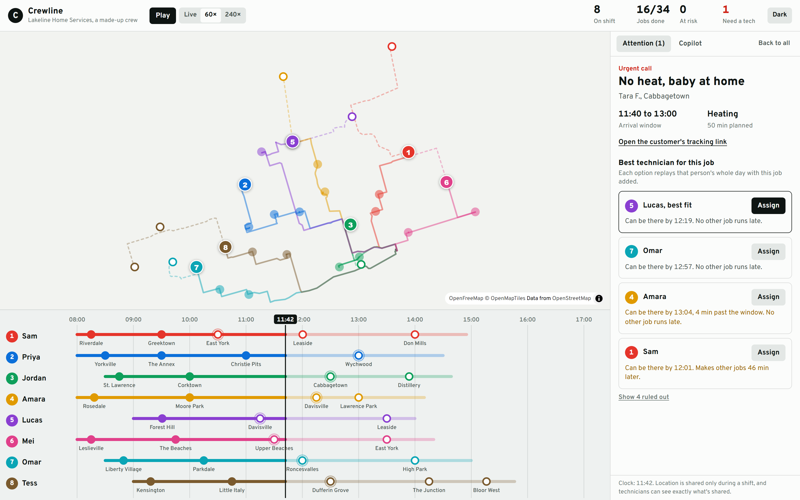
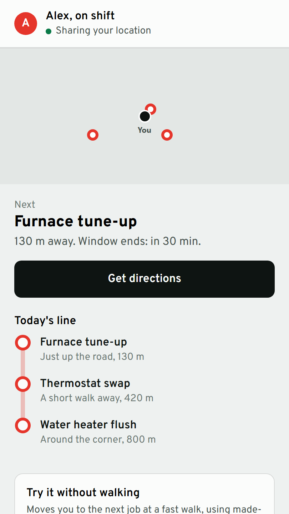
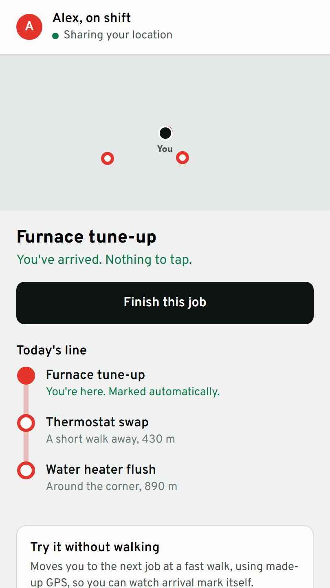
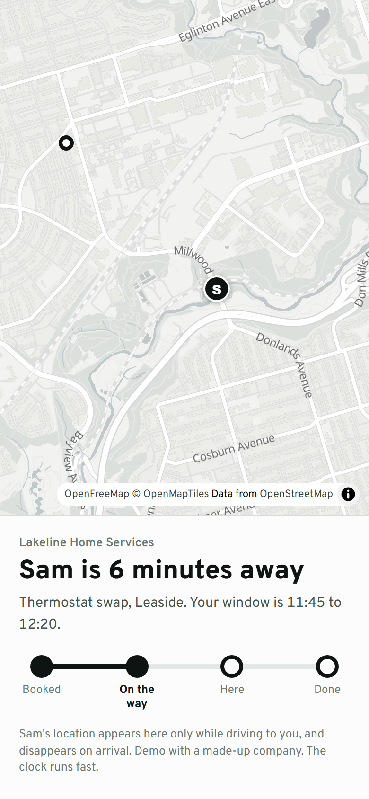
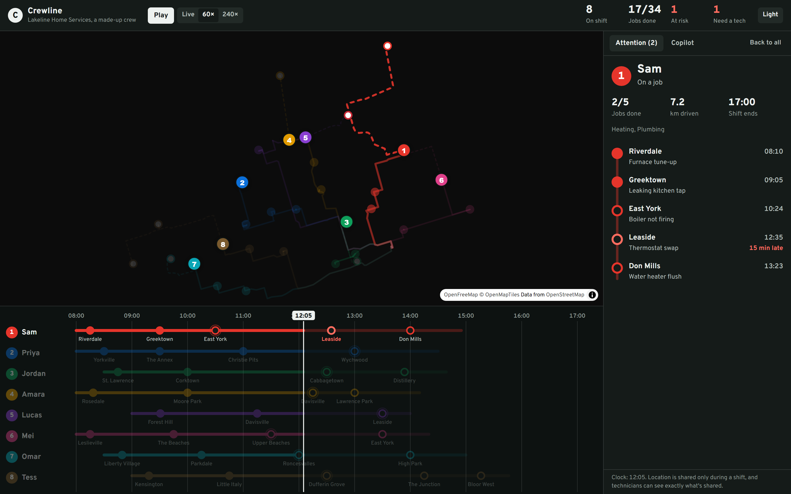

# Crewline

**Run a field crew like a transit line.**

A dispatch board, a customer tracking link and a phone app for field teams. Every technician is a coloured line and every job a station, so a dispatcher can read the whole crew's day at a glance, and drag back through it to replay any moment.



> **Demo project.** The company, crew and customers are made up. Places are real Toronto neighbourhoods, never house addresses.

## The moment it's built for

A no-heat call comes in at 11:42. Sam is the closest technician, and the obvious choice. Crewline replays each person's whole day with the job added, and shows that sending Sam makes later customers wait 46 minutes. Lucas arrives 18 minutes later and nobody else runs late. The dispatcher sees why, and decides.

## What's in it

**Dispatch board (Next.js)**
- Live map of the crew, with routes, trails and job pins
- The line board: one transit line per technician. Drag the time needle, or use the arrow keys, to replay the day
- Forecasts that only use what's known at that moment, so an overrun shows when it happens, not before
- At-risk jobs, ranked, and a plain note when someone loses GPS signal: the map shows their last known spot, not a guess
- An AI copilot on Google Gemini that reads the live board and suggests. Nothing is assigned until a person presses Assign

**Customer link**
- "Sam is 6 minutes away", on the same kind of line
- Shows the technician's location only while they're driving to that customer. It's built field by field, so nothing about other jobs or customers can leak

**Field app (Expo, for iOS and Android)**
- Your day as a vertical line, with directions to each job
- Arrival marks itself after a real stay at the site, so driving past doesn't count, and GPS drift at the edge doesn't flap
- Works through a dead zone: arrival detection runs on the phone, and location updates queue and catch up, safely, when the signal returns
- A practice walk, so anyone can try it without leaving the room

<p>
  
  
  
</p>



## Privacy is part of the design

Location tracking is easy to get wrong, so these are in the code, with tests:

- **Clocked in means sharing, clocked out means gone.** The server refuses location from anyone who hasn't clocked in, and clocking out erases theirs immediately.
- **No database of where people have been.** The tracking server keeps everything in memory.
- **Technicians see exactly what's shared**, before they clock in and throughout the shift.
- **Customers see one technician, briefly**, and only while that technician is on the way to them.
- **The AI model gets no customer names.** Its tools run in the browser and return only what a question needs.

## How it's checked

| Check | Result | Run it with |
|---|---|---|
| Unit and integration tests: forecast, ranking, geofence, GPS filter, offline queue, server, copilot, customer view | 85 pass | `npm test` |
| Browser flows through the dashboard, customer link and field app, including a phone clocking in, walking, arriving and clocking out live on the board | 31/31 | `node scripts/e2e.mjs` |
| Copilot on the real Gemini model: 10 questions, including an attempt to get customer details and a request to assign a job itself | 10/10, no invented times or names ([report](docs/copilot-report.json)) | see `apps/web/scripts/eval.ts` |
| Lint, types, production web build, Android and iOS bundles, Expo Doctor | Pass, in [CI](.github/workflows/ci.yml) | `npm run lint`, `npm run typecheck`, `npm run build` |

**Not tested yet:** the field app on a physical phone. Its logic and web build are tested above, and the Android and iOS bundles compile, but real GPS and the native map haven't been exercised. In Expo Go, sharing also pauses when the app isn't open; keeping it running needs a store build with background location permission.

## Run it

```bash
npm install
npm run dev
```

Open http://localhost:3700. The demo crew runs by itself, with no accounts or keys. For the AI copilot, copy `.env.example` to `apps/web/.env.local` and add a free [Google AI Studio](https://aistudio.google.com/) key. Without one, the copilot answers from built-in rules and says so.

To see a real phone on the board, start the tracking server, then the dashboard with `NEXT_PUBLIC_TRACKING_URL=ws://localhost:3710`, then the app:

```bash
npm run server
```

```bash
npm run mobile
```

Scan the QR code with Expo Go. The phone and computer need the same Wi-Fi.

## Deploy

- **Dashboard:** Vercel's free tier, with Root Directory `apps/web`. Set `GEMINI_API_KEY`. It works fully with the demo crew and no server.
- **Tracking server:** any small always-on machine, such as Oracle's free tier, since Vercel doesn't hold WebSockets open. Set `CREW_CODE` and `DISPATCH_TOKEN`, and put it behind TLS. A real deployment also needs dispatcher sign-in: `NEXT_PUBLIC_DISPATCH_TOKEN` is visible in the browser, so it's only suitable for a demo.

## Stack

Next.js 16, React 19, TypeScript, MapLibre with OpenFreeMap tiles, Tailwind CSS, Expo SDK 58, React Native, WebSockets, Zod, Vitest, Playwright, GitHub Actions, Google Gemini. Road routes are from [OSRM](https://project-osrm.org/) with [OpenStreetMap](https://www.openstreetmap.org/copyright) data.

```
packages/core/  the day, forecast, ranking, geofence and offline queue: plain TypeScript, shared by everything
apps/web/       dispatch board, customer link, copilot
apps/mobile/    the Expo field app
apps/server/    the tracking server
scripts/        browser tests and the route builder
```

## Licence

[MIT](LICENSE)
